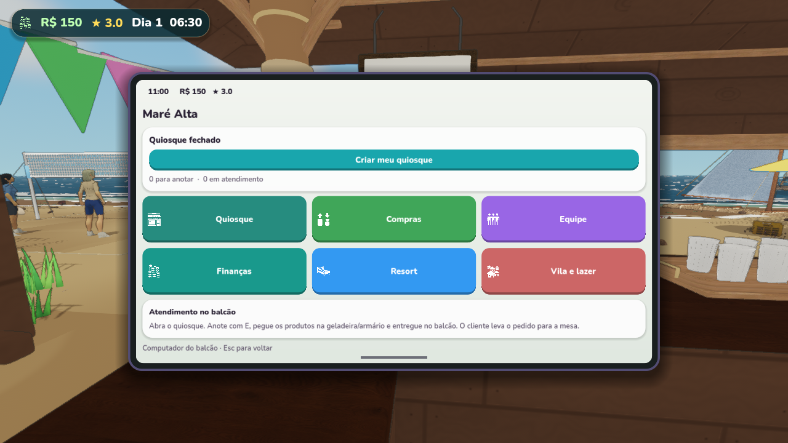
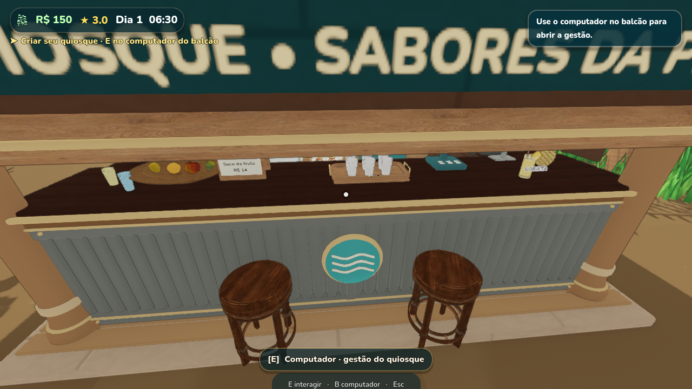
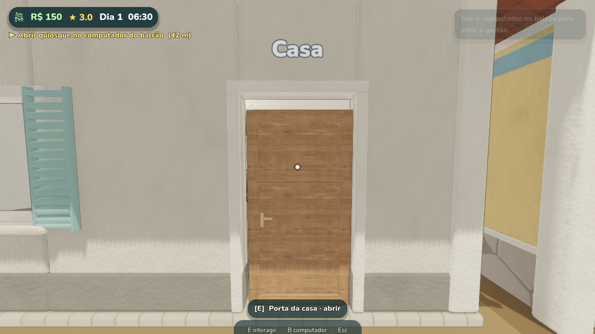

# Estado salvo para continuar com outra IA — 23/10/2026

O usuário pediu para salvar tudo até aqui e subir as instruções ao GitHub.
Este é um checkpoint de implementação, com pendências de validação explícitas.
Leia também AGENTS.md, CONTINUAR.md, COMPUTADOR_E_BALCAO.md e CLAUDE.md.

## Base e mudanças implementadas

- Repositório: sergiomrge-tech/simulador-resort.
- Branch: `codex/resort-1.1-mcp`. Continuar a versão 1.1.0 RC2, Godot 4.5.1.
- Gestão no computador físico do balcão, E no monitor; B só perto dele.
  Tela centralizada, cantos arredondados, seis áreas, layout mais compacto.
  Nome interno PhoneUI preservado por compatibilidade. Retirada e reposição
  continuam diretamente nas estações. A placa orienta para o computador.
- Quiosque começa fechado e exige abertura manual. Migração de save antigo
  fecha uma vez (opening_version=1), sem apagar o progresso. Dormir fecha novamente.
- Clientes reservam mesa, pedem e retiram todos os produtos no balcão, em pé,
  antes de sentar. Duas posições, fila, transporte dos itens e consumo na mesa.
  Garçom atende no balcão. Não restaurar preparo, pedido sentado nem cobrança dupla.
  Número do pedido usa a mesa reservada e fica estável durante o percurso.
  No modo físico as banquetas deixam de ser assentos de consumo para liberar retirada.
- Porta da casa em madeira com painéis/ferragens, E abre/fecha; colisão fechada
  bloqueia passagem. Fecha após sair com arco livre. Evita fechar no jogador.
- **Escolha explícita do usuário: tampo em madeira escura e base cinza.**
  Não repintar o balcão ao aplicar a identidade da empresa. Preservar textura.
- Seis copos na bandeja, caixa branca removida e promoções nas duas faces do
  expositor, com preços reais configurados e texto ajustado ao papel.
- Fontes Blender editáveis e incorporadas/reabertas, GLBs, geradores,
  importações e catálogo incluídos. Origem/licença em CREDITS.md.

## Verificação realizada e problemas restantes

Testes com APPDATA separado, sem usar/apagar saves reais. Renderização Vulkan
Forward+ na RTX 4060 Ti. Imagens do executável em images/computador-balcao.

No **fonte**, os logs finais registraram PASS: terminal, counter-first, company,
counter, practical, phone-layout, home, simulation e management. Os testes foram
ajustados para o novo fluxo; counter-first verifica movimento real, E, pedido
parcial/completo, estoque, fila, mesa e ausência de cobrança duplicada. Layout
confere todas as páginas em 1280×720, 800×600 e 360×640.

No **PCK exportado**, terminal e phone-layout registraram PASS com saída 0.
Counter-first e company registraram PASS lógico, mas o processo terminou com
**-1073741819 (access violation) durante o encerramento**. Não considerar essas
duas execuções inteiramente verdes. Já existiam avisos de material nulo/RIDs
ao encerrar no projeto anterior; a causa do access violation não foi resolvida.
Não há evidência de erro de script/recurso ausente nesses testes específicos.
Próximo passo: repetir as execuções e investigar a liberação de recursos da cena.

O **ciclo geral legado** (`--loop-test`, sem teste específico) foi executado no
PCK e apresentou falhas no trecho do balcão: prompt vazio, venda de R$0, cliente
não entrou em keat, contador e combo não avançaram; rush sem chegadas/atendimentos.
A execução terminou com **LOOP_TEST FAIL** (dinheiro=5230, estrelas=4,34, bar=74).
As falhas foram registradas para a próxima IA; não foram corrigidas neste checkpoint.
Investigar a mira/fixture legada após a mudança do Interactable do balcão
(profundidade 1,4→0,6 m para não interceptar o PC). Não contornar removendo
as verificações nem restaurar atendimento sentado no modo físico.
Para o rush, conferir também a fixture de abertura: o novo padrão é fechado,
então o teste legado deve abrir explicitamente antes de esperar chegadas.

## Build local e entrega ainda pendente

- Projeto: `C:/Users/sergi/Documents/ChatGPT/resort 2`.
- Engine correta: `C:/Users/sergi/Documents/ChatGPT/Gestao Facil/Ilha Selvagem/tools/Godot_v4.5.1-stable_win64.exe`
  e console sibling. Não usar D:/Godot (outra versão).
- Executável local: `build/rc2-playable/MareAltaResort.exe`; PCK exportado nesta
  revisão com 1.798.930.836 bytes. Exportação concluída sem erro de script.
  SHA256: `aea7e17c96e4d87a841d4d54a65da502cf690be1f8af679d0aafe7fabcdd5281`.
- **ZIP em Downloads ainda é da revisão anterior** (23/10 às 16:40):
  `C:/Users/sergi/Downloads/MareAltaResort_1.1_CaisCorrigido.zip`.
  Não dizer ao usuário que esse ZIP já contém as mudanças atuais.
- Após resolver/registrar os testes pendentes, usar
  `tools/package_quiosque_portable.py` para atualizar o ZIP. O script já contém
  README e documentação novos; o empacotamento desta revisão ainda não foi rodado.
- Logs/capturas completos permanecem em build/logs e build/qa (não versionados).
  Não subir build, saves ou caches gigantes ao Git.

## Comandos úteis

PowerShell na raiz do projeto:

```powershell
./tools/run_counter_batch.ps1 -Checks @('terminal','counter-first','company')
./tools/run_counter_batch.ps1 -Exported -Checks @('terminal','counter-first','company','phone-layout')
./tools/run_counter_batch.ps1 -Exported -Checks @('loop')
build/python/Scripts/python.exe tools/gen_item_catalog.py
```

O helper cria APPDATA isolado e verifica PASS, erros de script e código de saída.
`loop` aciona o ciclo geral; não há teste separado loop_regression.gd.
Exportar com `prune_export.py apply`, Godot 4.5.1 `--export-pack 'Windows Desktop'`,
e restaurar o preset com `prune_export.py restore` em finally. Testar o executável
sem --path para confirmar que usa o PCK. Preservar os arquivos da instalação antiga.

## Imagens do executável






